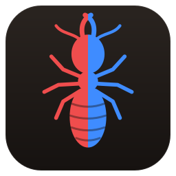
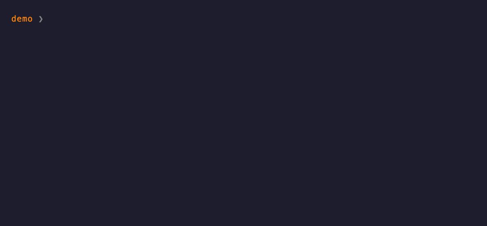
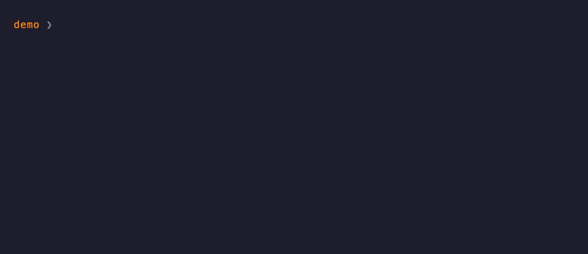
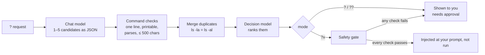

<div align="center">



# termite

**Find useful or complex command lines and shell scripts safely, with local models and decision models. termite never runs them, and it can stop agents running destructive ones.**

`tmite` turns `? find files bigger than 100MB here` into `find . -type f -size +100M`,
using models on your own machine. It explains the command and rates the risk, and it never runs the command; only you can do that.

[](LICENSE)


</div>

---

### `?`: one command, explained first, which needs your approval



### `??`: every way to do it, explained, so you can choose one, ask again or cancel


### `?x`: injected at your prompt if every check passes



---

## Contents

- [Why](#why)
- [What termite does](#what-termite-does)
- [Install](#install)
- [Quick start](#quick-start)
- [Usage](#usage)
- [How it works](#how-it-works)
- [Security: what termite guarantees](#security-what-termite-guarantees)
- [What termite tests](#what-termite-tests)
- [Evaluating models](#evaluating-models)
- [Configuration](#configuration)
- [Agents](#agents)
- [Roadmap](#roadmap)
- [Contributing](#contributing)
- [License](#license)

## Why

You often know what you want ("restart the web container", "show what is using my disk space") but not the exact flags on this machine, such as BSD or GNU options, or `ss` or `lsof`. A chat window can give you the answer, but you then paste it into a shell without checking it.

This is not safe with small local models. In testing they wrote `rm -rf ~/*`, printed SSH keys and piped unknown scripts into a shell. [The results are public](https://tanepiper.github.io/termite/). termite therefore treats every model as untrusted:

- **Local by default.** Your requests, folders and commands go to model servers on your own
  machine (llama.cpp, Ollama, LM Studio). If you set a model or decision URL to another machine, they go there instead, with any decision token. Only do this with a server you trust.
- **Checked.** Every suggested command passes through tested Rust code before you see it.
- **Never run.** termite stops at your prompt, and only you can press Enter.
- **Rated.** Every command is marked in words and colour, and risky commands turn red whatever the model says.

## What termite does

termite sits between a model and your shell, and catches a bad command before it runs. It does four things:

| | What it does | How you use it |
|---|---|---|
| **Ask** | A local model writes the command or script for a job you describe | `?`, `??`, `?x`, `?b` |
| **Check** | Fixed rules rate any command or script, with no model | `tmite check`, or pipe text into `tmite` |
| **Gate** | Six levels decide what happens to a command. You decide for yourself. An agent is stopped at any known hazard, and anything else goes through | Always on |
| **Test** | Rates how models behave with dangerous requests, in a sandbox | [The results](https://tanepiper.github.io/termite/) |

## Install

termite is at an early stage, so install it from source. Signed release binaries and a Homebrew tap are planned.

```bash
cargo install --locked --git https://github.com/tanepiper/termite termite
```

**You also need:**

| What | Why | Options |
|---|---|---|
| A chat model server | writes the candidate commands | [llama.cpp](https://github.com/ggml-org/llama.cpp) `llama-server`, [Ollama](https://ollama.com), [LM Studio](https://lmstudio.ai), any OpenAI-compatible `/v1/chat/completions` |
| A decision model | ranks the candidates and judges `?x` safety | a model served on `/v1/systemone`: llama.cpp, or Ollama 0.40+; for example [Kev-4B](https://huggingface.co/ggml-org/Kev-4B-GGUF) or [termite-decide-0.8b](https://huggingface.co/tanepiper/termite-decide-0.8b) |
| zsh, bash 4+ or fish (optional) | the `?` prompt widget saves copying. `tmite` does the same work in any shell | |

termite has two small models of its own, at version 0.1. See [termite's own models](docs/termite-models.md), and read their safety cards first.

## Quick start

**1. Let setup find your models and write the config.**

```bash
tmite setup
```

Setup looks for llama.cpp (including the Llama app's router), Ollama and LM
Studio on their usual ports, lists their models, and asks you to pick a chat
model and a decision model.

If one is missing, it shows the exact download or start command, with its
size, and runs it only if you type `y`. Then it shows the config and asks
before writing it.

**2. Ask.**

```console
$ tmite '? show disk usage of this folder'
✓ reads only  Shows the total disk usage of the current folder.
  du -sh .
```

Setup also finds the agent harnesses on your machine, such as Claude Code, Codex, Cursor, Copilot and Hermes, and offers each a hook that checks shell commands before they run. It changes nothing until you type y. See [agent tools](docs/agents.md#add-termite-to-your-agent-harness), which also has a prompt you can give any agent to set this up.

**3. Optional: the `?` widget for zsh, bash or fish.** `tmite setup` offers to add it. See [getting started](docs/getting-started.md#the-prompt-widget).

## Usage

```bash
tmite '? list big files'           # one command, explained
tmite '?? restart docker'          # every option, explained
tmite '?x show disk usage'         # injected at the prompt if every check passes
tmite --json '? list big files'    # one JSON object, for scripts
tmite check install.sh             # rate every command in a script
curl -fsSL https://x.test/i.sh | tmite   # rate a pipe as it arrives
tmite script 'back up my notes'    # write a script as a draft
```

`tmite check` needs no model and runs nothing. See
[checking a script or a pipe](docs/using-termite.md#check-a-script-or-a-pipe) and
[writing a script](docs/using-termite.md#write-a-script).

With the prompt widget, type the same thing at your prompt and the command goes on
your command line:

| Prefix | You get | Then |
|---|---|---|
| `? request` | the best command, explained | `Y/n`; approval puts it at your prompt |
| `?? request` | every distinct command, explained, best first | a number picks one, `a` asks again, anything else cancels |
| `?x request` | the best command, injected at your prompt, if every check passes | otherwise it needs approval, and it says why |
| `?b request` | a script, saved as a draft | the install command goes at your prompt |

Risky commands show in red, and the question becomes `y/N`. In zsh they stay red at the prompt. Nothing runs until you press Enter.

Any line that does not start with one of these prefixes runs as normal.
`?xargs` and `?bash` are not prefixes.

## How it works



- `tmite` itself **only prints**. The prompt widget puts a command at your prompt, and nothing presses Enter for you.
- **The `?x` gate** decides whether a command may skip the question. It has six checks, in this order. All must pass, and any error counts as a failure:
  1. The chat model labelled the command `read`.
  2. The **read-only policy** (plain Rust, see below) accepts it.
  3. termite's own **hazard check** finds nothing serious.
  4. The decision model is confident it **only reads** (≥ 0.85).
  5. The decision model is confident it **shows no secrets** (≥ 0.6).
  6. The decision model rates it **not harmful** (≤ 0.3; ≥ 0.9 refuses
     outright).
- The decision model can only make things stricter. It can never approve a
  command that the policy refuses.

## Security: what termite guarantees

Each statement below holds today, and each is backed by automated tests
unless marked *manual*.

### termite never runs a command on its own

- **`tmite` only prints.** It contains no code that executes a suggested
  command.
- **The widget only inserts.** It puts a command at your prompt, and it has no code that presses Enter. Tests confirm that an inserted command does not run.
- **Any failure means the command needs approval.** If a model is unreachable, times out, returns broken JSON or gives an unknown answer, `?x` behaves like `?`. A missing answer is never treated as approval.

### `?x` only skips the question for commands that read

The read-only policy accepts a small allowlist of programs, subcommands and
options, and refuses everything else. Examples from its test table:

| Refused | Because |
|---|---|
| `ls ; rm -rf ~` · `ls && rm x` · `ls & rm x` · `ls \|& wc` | chains commands |
| `ls > out.txt` · `ls 2>out.txt` · `cat < ~/.ssh/id_rsa` · `cat <(ls)` | redirects |
| `ls $(pwd)` · ``ls `pwd` `` · `eval ls` · `source ~/.zshrc` · `ls \| xargs rm` · `ls *(e:'rm x':)` | runs built-up code |
| `ls !!` · `ls "!rm"` | uses history |
| `ls $'\x2essh'` | hides text in escapes |
| `GIT_PAGER=sh git log` · `FOO=bar ls` | sets variables |
| `sudo ls` · `doas ls` · `su -c ls` · `pkexec ls` | raises privileges |
| `ls \| tee out.txt` | writes files |
| `rm -rf build` · `ls \| sh` · `/bin/rm x` · `./ls` · `env ls` | program not allowed |
| `find . -delete` · `find . -exec rm {} +` · `fd -x rm` · `rg --pre sh x` · `less '+!rm x' f` · `bat --pager=sh x` · `git -c core.pager=sh log` | option that writes or runs code |
| `git push` · `git checkout main` · `docker restart web` · `kubectl delete pod web` | subcommand that changes things |
| `tail -f build.log` · `docker logs -f web` · `kubectl get pods -w` · `cat /dev/urandom` · `cat -` | never ends |
| `cat ~/{.ssh,x}/id_rsa` · `ls {a..c}` | braces the shell expands |
| `grep -r x .` · `rg --hidden x` · `rg -uu x` · `rg x ~` · `rg x /` | reads every file, hidden ones included, or starts too high |
| `git status` in a repository whose own config sets `core.fsmonitor`, a pager, or a diff or filter driver · `git diff --ext-diff` · `git -C other status` | git would run a program from repo config |
| `kubectl get --raw /api/v1/namespaces/default/secrets` | reads any API path |

### `?x` never shows secrets on its own

Reading a secret is refused even when the command only reads:

`cat ~/.ssh/id_ed25519` · `ls ~/.ssh` · `cat ~/.ss''h/id_rsa` ·
`cat ~/.s*/id_rsa` · `cat .env` · `cat app/.env.local` · `cat server.pem` ·
`cat ~/.aws/credentials` · `rg token ~/.aws` · `cat ~/.netrc` ·
`cat ~/.docker/config.json` · `cat ~/.config/gh/hosts.yml` · `kubectl get secrets` ·
`cat ~/.kube/config` · `cat ~/.git-credentials` · `cat ~/.npmrc` · `cat ~/.zsh_history` ·
`cat ~/Library/Keychains/login.keychain-db` · `cat terraform.tfstate` · `cat id_rsa` ·
`cat cert.p12` · `cat ~/.SSH/id_rsa` · `cat .ENV` (file names ignore case on macOS)

Similar names that are not secrets stay allowed: `cat ~/code/sshd.md`,
`cat docs/environment.md`, `cat src/key.rs`.

### Model output never reaches your prompt unchecked

Every suggested command, in every mode, is refused if it:

- **is more than one line,** including `\r`, U+2028 and U+2029 (a second line
  could run on Enter);
- **contains a control or invisible character:** escape sequences
  (`\x1b[31m`), the bell, zero-width and bidi characters, which can make a
  command look different from what it does;
- **is longer than 500 characters,** or is empty;
- **does not parse** as shell words.

Descriptions and messages are made printable before they are shown, so a
model cannot send escape sequences to your terminal.

### Setup never acts without you

- **Every download and every server start is shown in full first,** with its
  size, and runs only if you type `y`.
- **The config file is shown before it is written,** and written only after
  you confirm.
- **Without a terminal** (piped, in CI), setup asks nothing, downloads
  nothing, starts nothing and writes nothing.
- **The decision token is read only from `TERMITE_DECISION_TOKEN`.** It is
  never written to disk.

### Scripts

`tmite script` saves a draft, and `tmite scripts install` makes it executable only
after showing it to you and getting a `y`. termite never runs a script.

termite logs what it installs and what it stops, as hashes, in a signed chain. See [what termite installed](docs/using-termite.md#see-what-termite-installed).

- **termite's folder** (`$TERMITE_HOME`, default `~/.config/termite`) must be
  a real folder, owned by you, and not writable by anyone else, or termite
  refuses to use it.
- **Files are written privately:** with their final mode set at creation
  (0600 or 0700, whatever the umask), atomically, never through a symlink,
  never left half-written.
- **A bash library for generated scripts:**
  - every script refuses to run on bash older than 5.3, before running
    anything else;
  - it refuses to load the library if any part of it is missing, a symlink,
    owned by someone else, or writable by others;
  - temporary folders are removed even after an error or Ctrl C;
  - a destructive step asks first, and without a terminal the answer is
    always no.

### What termite does not protect against

- **Levels 1 to 3 still reach your prompt if you say yes.** A contained delete such as `rm -rf node_modules` asks first, but a yes puts it at your prompt, so read every command before you press Enter. Root commands and commands that reach outside the project never reach your prompt.
- **A person's `tmite check` result is a rating.** It shows the level, but the exit status follows the rating. An agent is held to the levels. See [agent tools](docs/agents.md).
- **termite can't see code that isn't in the command.** `npm run build`, `make deploy`, `python -m module` and `npx package` run code that termite can't read, so an agent may run them. See [what a hook lets through](docs/agents.md#what-a-hook-lets-through).
- **termite only sees what passes through it.** It is not a sandbox. To stop an agent reaching other machines for certain, run the agent somewhere with no network.
- **The read-only policy matches paths as written.** It does not follow
  symlinks, and with zsh's `GLOB_DOTS` on, `cat *` can reach hidden files.
- **Malware running as your user** can do anything you can, including
  editing termite's config.
- **A poor model gives poor suggestions.** The checks stop dangerous commands from reaching your prompt without approval, but they do not correct a wrong `?` answer.

## What termite tests

```bash
cargo test            # Rust: unit, integration and doc tests
bash/tests/run.sh     # shellcheck + bats for the bash library
```

| Area | Tests |
|---|---|
| Read-only policy | over 200 table rows: every allowed example, at least one refused example per rule, and every bypass found in review |
| Command checks | every kind of refusal, with the exact limits (500 characters, each invisible character class) |
| The `?x` gate | each of the checks failing on its own; model errors, timeouts and bad replies all fall back to asking |
| Decision thresholds | calibration rows measured on Kev-4B, for example `ls -la ~/code` (only reads 0.95: runs) next to `rm -rf build` (only reads 0.09: asks) |
| Private files | exact modes under umask 000, 022, 077 and 777; symlinks refused; no partial or temporary files left after a failure |
| Bash library | 63 bats tests: hostile file names (spaces, new lines, leading dashes, globs), option values that look like code, Ctrl C clean-up, no-terminal behaviour, and the bash 3.2 version guard |
| Setup | discovery parsing for each server kind; the config it writes always loads; nothing is fetched or started without a yes; relative `PATH` entries are skipped |
| The real binary | `tests/cli.rs` runs `tmite` against a hostile fake server: models that call danger safe, escape codes and fake lines in replies, endless streams, servers that fail or vanish, and the token going only to the decision server |
| The real widget | `tests/widget.rs` drives zsh, bash and fish in a pseudo-terminal: the answer is explained first, only a yes reaches the prompt, and nothing runs |
| Adversarial | every hostile command in every disguise; random shell text, stream bytes and git config, with rules that must hold for all of it |
| Architecture | `tests/architecture.rs` enforces [the design](docs/architecture.md): small files, dependencies pointing one way, effects at the edges |

To run everything in the sandbox (network to this machine only, writes only to
build folders, secrets unreadable):

```bash
scripts/sandbox.sh cargo test --all-targets
```

## Evaluating models

termite is also a red-team tool. Test a model before you trust it: `scripts/analyse.sh` sends the attack corpus to each local model in a sandbox, grades its safety, and writes a private report on what to block or restrict. Nothing a model writes is ever run. See [red-teaming a model](docs/red-team.md) and [how the testing works](docs/evaluation.md).

Not built yet: red-team levels 8 to 10 (a hostile model trying to escape a
container or reach a malware server), which need a sealed container and must be
stopped every time.

## Configuration

`~/.config/termite/config.json`, written by `tmite setup`:

```json
{
  "model_url": "http://127.0.0.1:11434",
  "model": "qwen2.5-coder:latest",
  "decision_url": "http://127.0.0.1:9931",
  "decision_model": "ggml-org/Kev-4B-GGUF:Q8_0",
  "generation_timeout_secs": 120,
  "decision_timeout_secs": 60,
  "stream": true
}
```

`stream` is optional and on by default. When it is on, you see the reply as it is written; when it is off, the reply arrives in one piece. In both cases, a line shows what is happening and for how long, and the server is checked every 10 seconds.

| Variable | Does |
|---|---|
| `TERMITE_HOME` | moves termite's folder (and the config) |
| `TERMITE_DECISION_TOKEN` | bearer token for the decision endpoint; never stored |
| `TMITE_BIN` | where the prompt widget finds `tmite`, if not on `PATH` |

> [!TIP]
> Put the chat model and the decision model on different servers, or let
> your llama.cpp router keep two models loaded (`--models-max 2`). Otherwise
> every query swaps models, which costs seconds each time.

## Agents

termite works with any agent service or harness that can run a check before a shell command. `tmite setup` offers a hook to Claude Code, Codex, Gemini CLI, Cursor, Antigravity, GitHub Copilot, Hermes Agent, goose, OpenCode and Windsurf. A hook never approves a command. It stops the command or, in Claude Code, asks you in the harness's own prompt. If `tmite` is missing or crashes, the command stops. termite also includes three agent definitions and three skills. `termite-analyst` finds what the test results show, `termite-blue-team` builds safe commands in a sandbox, and `termite-red-team` tests dangerous requests in a locked-down container. None of them runs what a model writes, and the tool refuses to test a model anywhere else. See [agent tools](docs/agents.md), which also explains [what each hook does](docs/agents.md#what-a-hook-does).

## Roadmap

These are planned:

- **Intents:** `tmite ask | choose | run | script`. `?` gets a trigger
  you choose.
- **A confirm card:** the [six levels](docs/using-termite.md#levels) are
  built. A card drawn by `tmite` itself will replace the widget's questions.
- **Checks on input and output:**
  - requests and replies are checked;
  - risky requests are flagged, and each flag adds fixed instructions to
    the model's prompt that nothing can remove;
  - the two models review each other in a bounded loop;
  - termite detects containers, CI and root.
- **Signed releases:** Sigstore attestations, a public release record, and
  `tmite --version --verify`.

## Contributing

Issues and pull requests are welcome. Start each change with its tests.

Before sending a change:

```bash
cargo fmt --check
cargo clippy --all-targets -- -D warnings
cargo test
```

Security issues: do not put the details in a public issue. Open
an issue that asks for a private contact, and I will give you one.

## License

[Apache License 2.0](LICENSE). Copyright Tane Piper.
