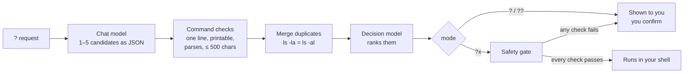

<div align="center">


# termite

**Ask your terminal in plain words. Get a checked shell command from a local model.**

`tmite` turns `? find files bigger than 100MB here` into `find . -type f -size +100M`,
using models that run on your own machine. Nothing it suggests reaches your
prompt unchecked, and it never runs anything you didn't ask it to.

[](LICENSE)


</div>

---

### `?` — one command, you confirm


### `??` — every distinct way to do it, best first, you choose


### `?x` — runs straight away only when every safety check passes


<sub>Recorded with the real tool and real local models (Qwen2.5-Coder on Ollama for commands, Kev-4B on llama.cpp for decisions). Re-record with <code>docs/tapes/record.sh</code>.</sub>

---

## Contents

- [Why](#why)
- [Install](#install)
- [Quick start](#quick-start)
- [Usage](#usage)
- [How it works](#how-it-works)
- [Security: what termite guarantees](#security-what-termite-guarantees)
- [What we test](#what-we-test)
- [Configuration](#configuration)
- [Roadmap](#roadmap)
- [Contributing](#contributing)
- [License](#license)

## Why

You know what you want ("restart the web container", "what's eating my
disk"), but not the exact flags on this machine: BSD or GNU, `ss` or `lsof`.
A chat window can tell you, but you paste its answer into a shell on trust.

termite keeps the convenience and drops the trust:

- **Local.** Your requests, folders and commands go to model servers on
  your own machine (llama.cpp, Ollama, LM Studio), not to a cloud.
- **Checked.** Every suggested command is checked by plain, tested Rust code
  before you see it.
- **Asked.** You confirm every command, except read-only ones you
  explicitly asked to run with `?x`, and those must pass every check.

## Install

termite is early: install it from source. Signed release binaries and a
Homebrew tap are planned ([release provenance spec](specs/2026-11-04-release-provenance/spec.md)).

```bash
cargo install --locked --git https://github.com/tanepiper/termite
```

**You also need:**

| What | Why | Options |
|---|---|---|
| A chat model server | writes the candidate commands | [llama.cpp](https://github.com/ggml-org/llama.cpp) `llama-server`, [Ollama](https://ollama.com), [LM Studio](https://lmstudio.ai), any OpenAI-compatible `/v1/chat/completions` |
| A decision model | ranks the candidates and judges `?x` safety | a model served on `/v1/systemone`: llama.cpp, or Ollama 0.40+; for example [Kev-4B](https://huggingface.co/ggml-org/Kev-4B-GGUF) |
| zsh | for the `?` prompt widget (the CLI works in any shell) | |

## Quick start

**1. Let setup find your models and write the config.**

```bash
tmite setup
```

Setup looks for llama.cpp (including the Llama app's router), Ollama and LM
Studio on their usual ports, lists their models, and asks you to pick a chat
model and a decision model.

If one is missing, it shows the exact download or start command, with its
size, and runs it only if you type `y`. Then it shows the config and asks
before writing it.

**2. Turn on the `?` widget in zsh.**

```bash
echo 'source /path/to/termite/shell/tmite.zsh' >> ~/.zshrc
```

**3. Ask.**

```console
$ tmite '? show disk usage of this folder'
du -sh .
  Shows the total disk usage of the current folder. (read, score 1.00)
```

## Usage

At a zsh prompt with the widget loaded, start a line with a prefix and press
Enter:

| Prefix | You get | Then |
|---|---|---|
| `? request` | the best command, put at your prompt | Enter runs it; you can edit it first |
| `?? request` | every distinct command, best first, with descriptions and scores | press its number to put it at the prompt |
| `?x request` | the best command, **run at once** if every check passes | otherwise it behaves like `?` and says why |

Any line that doesn't start with one of these prefixes runs as normal.
`?xargs` and `?bash` are not prefixes.

From any shell, or a script:

```bash
tmite '?? restart docker'          # readable output
tmite --json '? list big files'    # one JSON object, for scripts
```

| Exit status | Meaning |
|---|---|
| 0 | a command to use |
| 2 | no usable command, or refused |
| 1 | an error (model unreachable, bad reply, config) |
| 64 | bad usage |

## How it works



- `tmite` itself **only prints**. Running a command is left to your shell:
  the zsh widget puts it at the prompt, or, for `?x` when every check
  passed, presses Enter for you.
- **The `?x` safety gate** is five checks, in this order. All must pass, and
  any error counts as a failure:
  1. The chat model labelled the command `read`.
  2. The **read-only policy** (plain Rust, see below) accepts it.
  3. The decision model is confident it **only reads** (≥ 0.85).
  4. The decision model is confident it **shows no secrets** (≥ 0.6).
  5. The decision model rates it **not harmful** (≤ 0.3; ≥ 0.9 refuses
     outright).
- The decision model can only make things stricter. It can never approve a
  command that the policy refuses.

## Security: what termite guarantees

Each statement below holds today, and each is backed by automated tests
unless marked *manual*.

### termite never runs a command on its own

- **`tmite` only prints.** It contains no code that executes a suggested
  command.
- **Only `?x` runs anything,** through your own shell's Enter, and only after
  all five checks pass.
- **Any failure means no auto-run.** A model that is unreachable, times out,
  returns broken JSON, or gives an unknown answer turns `?x` into `?`. No
  answer is never taken as yes.
- **Aliases and functions don't count as plain commands** *(manual)*. If any
  program in the command is an alias or a function in your shell, the widget
  does not run it, even when every check passed: `ls` could be an alias for
  anything.

### `?x` only runs commands that read

The read-only policy accepts a small allowlist of programs, subcommands and
options, and refuses everything else. Examples from its test table:

| Refused | Because |
|---|---|
| `ls ; rm -rf ~` · `ls && rm x` · `ls & rm x` · `ls \|& wc` | chains commands |
| `ls > out.txt` · `ls 2>/dev/null` · `cat < ~/.ssh/id_rsa` · `cat <(ls)` | redirects |
| `ls $(pwd)` · ``ls `pwd` `` · `eval ls` · `source ~/.zshrc` · `ls \| xargs rm` · `ls *(e:'rm x':)` | runs built-up code |
| `ls !!` · `ls "!rm"` | uses history |
| `ls $'\x2essh'` | hides text in escapes |
| `GIT_PAGER=sh git log` · `FOO=bar ls` | sets variables |
| `sudo ls` · `doas ls` · `su -c ls` · `pkexec ls` | raises privileges |
| `ls \| tee out.txt` | writes files |
| `rm -rf build` · `ls \| sh` · `/bin/rm x` · `./ls` · `env ls` | program not allowed |
| `find . -delete` · `find . -exec rm {} +` · `fd -x rm` · `rg --pre sh x` · `less '+!rm x' f` · `bat --pager=sh x` · `git -c core.pager=sh log` | option that writes or runs code |
| `git push` · `git checkout main` · `docker restart web` · `kubectl delete pod web` | subcommand that changes things |
| `tail -f build.log` · `docker logs -f web` · `kubectl get pods -w` | never ends |

### `?x` never shows secrets on its own

Reading a secret is refused even when the command only reads:

`cat ~/.ssh/id_ed25519` · `ls ~/.ssh` · `cat ~/.ss''h/id_rsa` ·
`cat ~/.s*/id_rsa` · `cat .env` · `cat app/.env.local` · `cat server.pem` ·
`cat ~/.aws/credentials` · `grep -r token ~/.aws` · `cat ~/.netrc` ·
`cat ~/.docker/config.json` · `cat ~/.config/gh/hosts.yml` · `kubectl get secrets`

Look-alikes that aren't secrets stay allowed: `cat ~/code/sshd.md`,
`cat docs/environment.md`, `cat src/key.rs`.

### Model output never reaches your prompt unchecked

Every suggested command, in every mode, is refused if it:

- **is more than one line,** including `\r`, U+2028 and U+2029 (a second line
  could run on Enter);
- **contains a control or invisible character:** escape sequences
  (`\x1b[31m`), the bell, zero-width and bidi characters, which can make a
  command look different from what it does;
- **is longer than 500 characters,** or is empty;
- **does not parse** as shell words.

Descriptions and messages are made printable before they are shown, so a
model cannot send escape sequences to your terminal.

### Setup never acts without you

- **Every download and every server start is shown in full first,** with its
  size, and runs only if you type `y`.
- **The config file is shown before it is written,** and written only after
  you confirm.
- **Without a terminal** (piped, in CI), setup asks nothing, downloads
  nothing, starts nothing and writes nothing.
- **The decision token is read only from `TERMITE_DECISION_TOKEN`.** It is
  never written to disk.

### Building blocks already in place

These parts are built and tested, and will be used by the `tmite script`
feature:

- **termite's folder** (`$TERMITE_HOME`, default `~/.config/termite`) must be
  a real folder, owned by you, and not writable by anyone else, or termite
  refuses to use it.
- **Files are written privately:** with their final mode set at creation
  (0600 or 0700, whatever the umask), atomically, never through a symlink,
  never left half-written.
- **A bash library for generated scripts:**
  - every script refuses to run on bash older than 5.3, before running
    anything else;
  - it refuses to load the library if any part of it is missing, a symlink,
    owned by someone else, or writable by others;
  - temporary folders are removed even after an error or Ctrl C;
  - a destructive step asks first, and without a terminal the answer is
    always no.

### What termite does not protect against

Stated plainly, so you can judge it:

- **A command you confirm is yours.** `?` and `??` show you the command;
  read it before you press Enter.
- **Malware running as your user** can do anything you can, including
  editing termite's config.
- **A bad model gives bad suggestions.** The checks stop dangerous ones from
  running on their own. They don't make a wrong `?` answer right.

## What we test

```bash
cargo test            # Rust: unit, integration and doc tests
bash/tests/run.sh     # shellcheck + bats for the bash library
```

| Area | Tests |
|---|---|
| Read-only policy | 180 table rows: every allowed example, and at least one refused example per rule |
| Command checks | every kind of refusal, with the exact limits (500 characters, each invisible character class) |
| The `?x` gate | each of the five checks failing on its own; model errors, timeouts and bad replies all fall back to asking |
| Decision thresholds | calibration rows measured on Kev-4B, for example `ls -la ~/code` (only reads 0.95: runs) next to `rm -rf build` (only reads 0.09: asks) |
| Private files | exact modes under umask 000, 022, 077 and 777; symlinks refused; no partial or temporary files left after a failure |
| Bash library | 63 bats tests: hostile file names (spaces, new lines, leading dashes, globs), option values that look like code, Ctrl C clean-up, no-terminal behaviour, and the bash 3.2 version guard |
| Setup | discovery parsing for each server kind; the config it writes always loads |

Planned: red-team tests graded from level 1 (everyday requests) to level 10
(a hostile model trying to escape a container or reach a malware server).
They will run in a sealed sandbox, and levels 8–10 must be stopped every
time ([spec](specs/2026-11-04-intents-and-confirm-card/spec.md#6-red-team-tests-in-a-sandbox)).

## Configuration

`~/.config/termite/config.json`, written by `tmite setup`:

```json
{
  "model_url": "http://127.0.0.1:11434",
  "model": "qwen2.5-coder:latest",
  "decision_url": "http://127.0.0.1:9931",
  "decision_model": "ggml-org/Kev-4B-GGUF:Q8_0",
  "generation_timeout_secs": 120,
  "decision_timeout_secs": 60
}
```

| Variable | Does |
|---|---|
| `TERMITE_HOME` | moves termite's folder (and the config) |
| `TERMITE_DECISION_TOKEN` | bearer token for the decision endpoint; never stored |
| `TMITE_BIN` | where the zsh widget finds `tmite`, if not on `PATH` |

> [!TIP]
> Put the chat model and the decision model on different servers, or let
> your llama.cpp router keep two models loaded (`--models-max 2`). Otherwise
> every query swaps models, which costs seconds each time.

## Roadmap

These are designed and specified, with tickets:

- **Intents:** `tmite ask | choose | run | script`. `?` becomes a zsh
  plugin with a trigger you choose.
  ([spec](specs/2026-11-04-intents-and-confirm-card/spec.md))
- **A confirm card:**
  - ordinary commands go to your prompt;
  - root and destructive commands are **display only**: never inserted,
    never copied;
  - likely harmful commands are **withheld**.
- **Guards on input and output:**
  - requests and replies are checked;
  - risky requests are flagged, and each flag adds fixed instructions to
    the model's prompt that nothing can remove;
  - the two models review each other in a bounded loop;
  - termite detects containers, CI and root.
- **`tmite script`:** generates bash scripts that are reviewed before
  install, built on the tested library.
  ([spec](specs/2026-11-04-script-mode/spec.md))
- **Provenance:** a tamper-evident log of every file termite installs, and
  alerts when a guard trips.
- **Signed releases:** Sigstore attestations, a public release record, and
  `tmite --version --verify`.
  ([spec](specs/2026-11-04-release-provenance/spec.md))
- **Small, specialised models:** trained for shell work.
  ([notes](docs/training-tiny-models.md))

## Contributing

Issues and pull requests are welcome. The project works spec-first: each
feature has a spec under [`specs/`](specs), with owner answers and numbered
tickets, and each ticket starts with its tests.

Before sending a change:

```bash
cargo fmt --check
cargo clippy --all-targets -- -D warnings
cargo test
```

Security issues: please don't open a public issue with the details. Open
an issue asking for a private contact, and you'll get one.

## License

[Apache License 2.0](LICENSE). Copyright Tane Piper.
